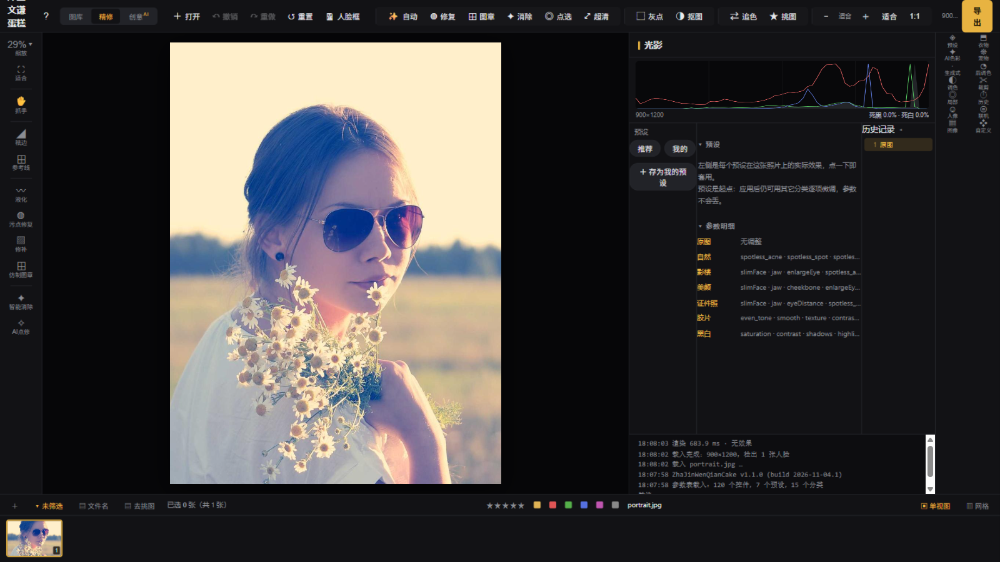
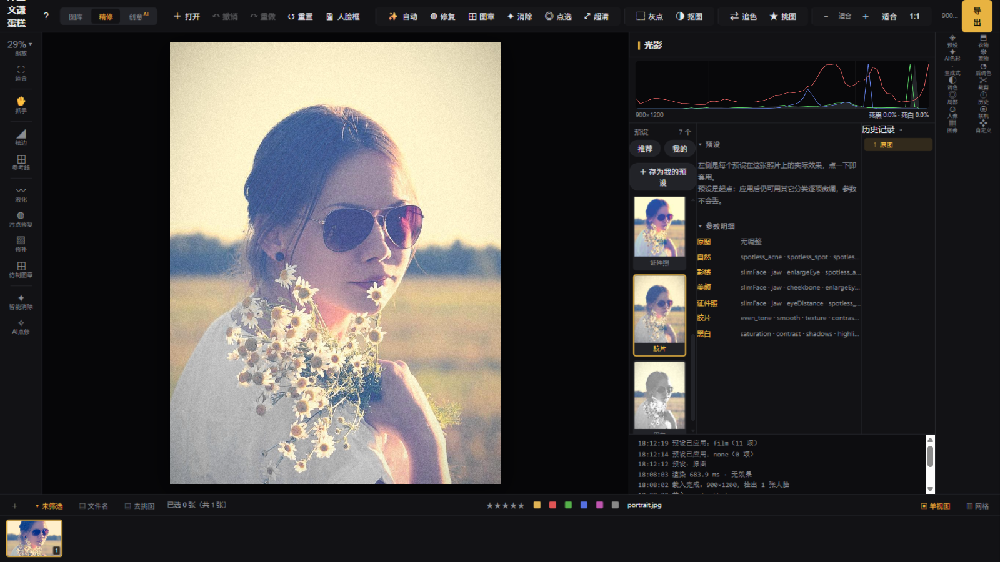
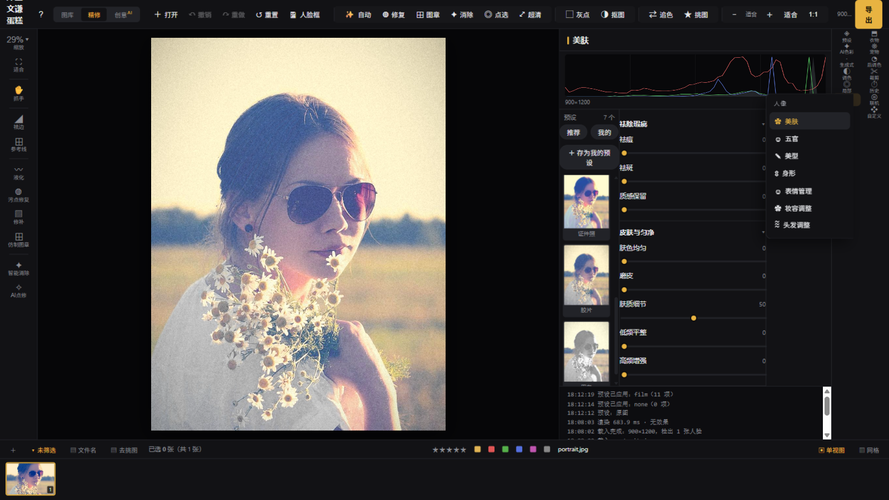

# ZhaJinWenQianCake (炸金文谦蛋糕)

A self-developed, **fully local AI portrait retouching studio** for Windows.
Photos never leave your machine — every model runs on-device.

> Chinese is the primary language of this project (docs, UI, commits).
> This page is a condensed English overview. The retouching UI itself is
> currently Chinese-only; an English UI is on the
> [roadmap](ROADMAP.md).

[中文 README](README.md) · [Screenshots](#screenshots) ·
[Download](https://github.com/wmc-ccb/ZhaJinWenQianCake/releases) ·
[Security policy](SECURITY.md) · [Third-party notices](THIRD_PARTY.md) ·
[Privacy](PRIVACY.md)

## What it is

A desktop application (no browser, no console — unzip and double-click)
for portrait photographers and retouching learners:

- **Portrait retouching** — skin smoothing, blemish/acne removal,
  liquify, face reshaping, teeth/eye enhancement (120 parameter controls,
  grouped in a two-level tool menu)
- **One-click presets** — live preview thumbnails rendered from *your*
  photo (natural / studio / beauty / film / mono / ID photo)
- **Object removal** — pedestrians, clutter, cables (deterministic
  LaMa inpainting + point-and-click grabCut)
- **Background work** — matting, sky replacement, four-seasons backdrop,
  grass fill, passport-photo sheet
- **Hands & feet, beach cleanup, red-eye** — batch-oriented tools for
  full-scene sets
- **Super resolution** — RealESRGAN x4, task-based progress + cancel
- **Batch export** — watermarks, naming templates, PNG/TIFF
- **RAW & tethered shooting** — NEF/CR2/CR3/ARW decode; shoot-tether
  workflow (Canon/Sony)
- **Generative fill (optional)** — FLUX.1 Fill via a local ComfyUI
  install; fully optional, everything else works without it

## Screenshots

**Main window** — preset live previews are real renders of your photo:

**Before / after** — one click, 11 parameters (film preset):

| Original | Film |
|---|---|
|  |  |

**Portrait tools** — two-level menu (skin / features / shape / expression
/ makeup / hair):

## Architecture

- **Engine**: Python + FastAPI, ONNX Runtime / PyTorch inference,
  incremental rendering with face-detection caching
- **UI**: pywebview (WebView2) native window over a single-page frontend
- **Desktop packaging**: PyInstaller onedir; models live in a writable
  folder beside the exe (replaceable); MSIX packaging ready
  (`tools/make_msix.py`)
- **Model distribution**: GitHub Releases + manifest with sha256 +
  size checks + resumable downloader, domain-whitelisted
- **Quality**: 11 headless engine regression suites running in CI
  (every push), extreme-stress test suite, API-level assertions

## Privacy & security by design

- Photos are processed **only in local memory**; there is no upload
  feature at all
- Network access is limited to: update check (GitHub API), optional
  first-run model download (GitHub domains, sha256-verified), and a
  LAN/tunnel remote-access mode you explicitly enable (password forced
  on tunnel traffic)
- No telemetry, no ads SDK, no accounts. See
  [PRIVACY.md](PRIVACY.md) and [SECURITY.md](SECURITY.md)

## Download

Windows 10/11 x64. Two builds per release:

| Build | Size | For |
|---|---|---|
| **lite** | ~5 GB | models download on first launch (980 MB, resumable, then fully offline) |
| **full** | ~6 GB | everything bundled, works fully offline out of the box |

From source: Python 3.11–3.13, `pip install -r requirements.txt`,
then `python tools/fetch_models.py` and `python server/app.py` (see
[CONTRIBUTING.md](CONTRIBUTING.md)).

## License

Source code: **AGPL-3.0** (with a commercial dual-license option — see
[LICENSE](LICENSE)). Pre-trained models keep their own licenses
(mostly Apache-2.0 / BSD; the insightface models are
research/non-commercial — documented per-file in
[THIRD_PARTY.md](THIRD_PARTY.md)).

## Project status

Actively maintained single-developer project; commits near-daily since
October 2026. See [CHANGELOG.md](CHANGELOG.md) and the public
[ROADMAP.md](ROADMAP.md) — contributions welcome
([guide](CONTRIBUTING.md), [Discussions](https://github.com/wmc-ccb/ZhaJinWenQianCake/discussions)).
